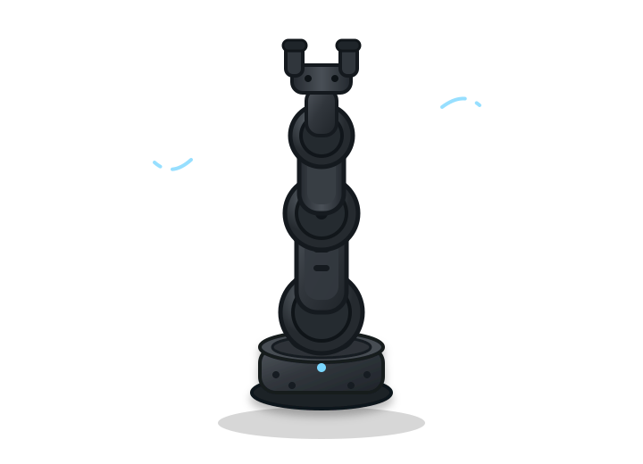

  

  <b>
    <a href="PORTFOLIO">Portfolio</a> ·
    <a href="RESUME">Resume</a> ·
    <a href="https://github.com/AryanKammili?tab=repositories">Projects</a> ·
    <a href="mailto:aryank@berkeley.edu">Email</a> ·
    <a href="LINKEDIN">LinkedIn</a>
  </b>

---

I'm a Computer Science and Applied Mathematics student at UC Berkeley
interested in **robotics, autonomous systems, machine learning, and
physical intelligence**. I enjoy building systems that connect perception,
localization, planning, and control to real-world machines.

My work has included autonomous robotics infrastructure, vision-based
localization, controls, simulation, and machine-learning applications.

 

<table>
<tr>
<td width="50%" valign="top">

### 🤖 Autonomous Robotics

Built autonomous robotics infrastructure spanning localization,
perception, planning, simulation, and control.

Implemented systems involving Kalman-filter-based localization,
vision-based pose estimation, autonomous trajectories, and
closed-loop controls.

**Java · Python · OpenCV · Robotics · Controls**

[View project →](#)

</td>

<td width="50%" valign="top">

### 👁️ Computer Vision

Build this section around one of your strongest perception or
computer-vision projects.

Explain the actual engineering challenge rather than simply
listing the tools used.

**Python · OpenCV · PyTorch**

[View project →](#)

</td>
</tr>

<tr>
<td width="50%" valign="top">

### 🧠 Machine Learning

A machine-learning system or research project you're particularly
proud of.

**Python · PyTorch · NumPy**

[View project →](#)

</td>

<td width="50%" valign="top">

### ⚙️ Systems / Simulation

A project demonstrating lower-level engineering, simulation,
infrastructure, or algorithms.

**Python · C++ · Linux**

[View project →](#)

</td>
</tr>
</table>

---

  <a href="mailto:aryank@berkeley.edu">Email</a> ·
  <a href="LINKEDIN">LinkedIn</a> ·
  <a href="https://github.com/AryanKammili">GitHub</a>

